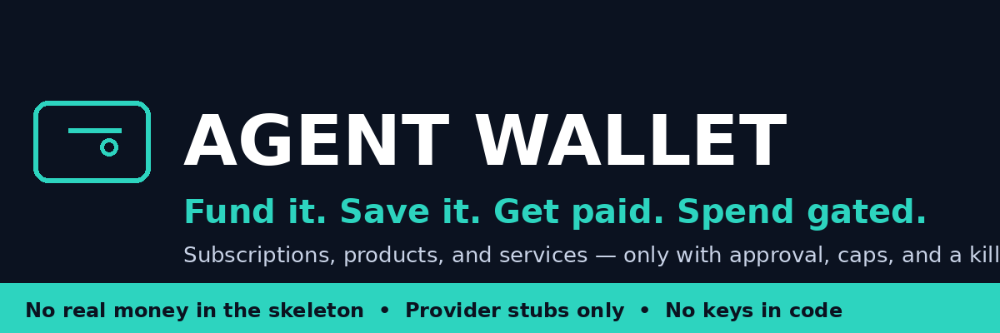
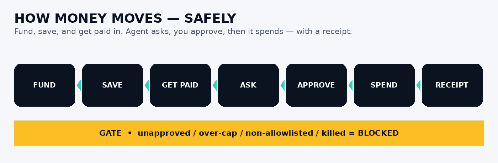
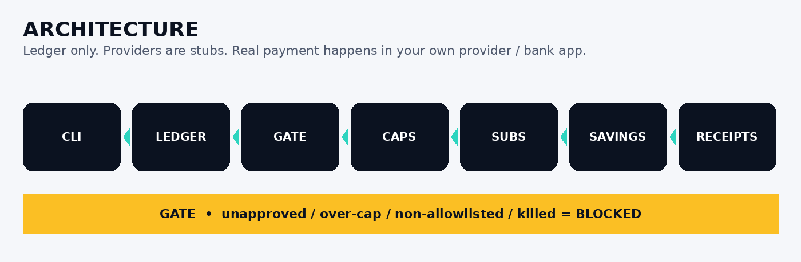
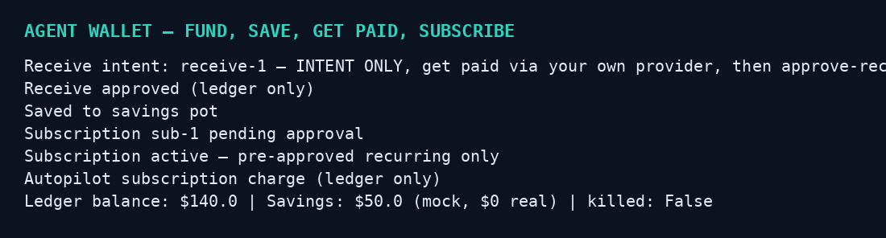
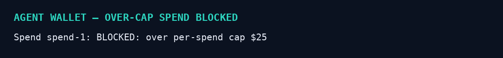

[](https://www.python.org/) [](https://opensource.org/licenses/MIT) [] [] [] [] []

# AGENT WALLET — A Wallet For Agent Frameworks

**One sentence:** A simple, local-first wallet ledger that lets a user fund an agent's work, and lets the agent spend *only* within caps, allowlists, and human approval — never on unchecked autopilot.

## Straight talk first — what this is, and what it is NOT

**This is NOT a real bank, payment processor, or crypto custodian.**
It does NOT move Visa money, Interac e-Transfers, PayPal money, Stripe money, or crypto. It does NOT hold your funds, and it does NOT let an agent spend your money while you're asleep with no limit.

Why: a real wallet that moves money needs, in real life:
- A licensed payment processor (Stripe / PayPal) with your own merchant account, KYC, and PCI compliance for cards
- A bank partnership for Interac e-Transfer — e-Transfer is bank-to-bank in Canada, there is no public API for an agent to send one on your behalf
- A crypto custody / MPC setup, with private keys never in code, never in a repo
- AML / fraud controls, chargeback handling, and tax reporting

Anyone who sells you a "fully autonomous agent wallet, just fund it and switch it on" without those is selling you a way to get drained, banned, or scammed. This framework is the *safe* version of that idea.

## What this skeleton DOES do

- **Funding intents, not money movement:** `fund --provider stripe|paypal|interac|visa|bitcoin|ethereum --amount 50` creates a *pending intent* that says "user intends to fund $50 via X". No money moves. Real funding happens in the provider's own checkout / bank app, by you.
- **Ledger, not custody:** balances are a local ledger of approved funding + approved spends. $0 real money in the skeleton.
- **Spend gate, always on:** every spend is blocked unless (1) you approved that exact spend, (2) it's under the per-spend cap, (3) it's under the daily cap, (4) the merchant/category is allowlisted, (5) the kill switch is off. Autopilot can *prepare* spends, it can never *execute* them alone.
- **Kill switch:** one command stops all spending instantly.
- **Receipts:** every fund intent, approval, and spend writes a PROOF-style hash-chained receipt, so you can verify what an agent spent, when, and why.
- **Provider stubs only:** Stripe, PayPal, Interac, Visa, Bitcoin, Ethereum are stubs in `wallet/providers.py` — they say "bring your own provider account, compliance is yours", they hold no keys and make no calls.

## The "autopilot, switched on" version — done safely

Autopilot in this framework means: agent prepares, scores, drafts, and queues spends 24/7. It does NOT mean: agent spends while you're asleep.
If you want true hands-off spending, the safe path is: pre-approved recurring spends only, to allowlisted merchants only, under a hard daily cap, with a receipt for every one, and a kill switch you can hit from your phone. That is a future, regulated step — not a skeleton claim.

## Quick start (mock, $0 real)

```bash
python3 run.py wallet create --owner Kevin --daily-cap 100
python3 run.py fund --provider stripe --amount 50
python3 run.py approve-fund --fund fund-1
python3 run.py spend --agent agent-1 --to "openrouter" --amount 5 --category models
python3 run.py approve-spend --spend spend-1
python3 run.py balance
python3 run.py kill
```

Unapproved, over-cap, non-allowlisted, or kill-switched spends are blocked and logged — they are never executed.

## Providers — how real funding would work, per provider

- **Visa / Stripe:** user pays via Stripe Checkout / Stripe Link in their own Stripe account. Agent wallet records the approved funding, it never sees the card.
- **PayPal:** user pays via PayPal checkout in their own PayPal account. Same ledger-only record.
- **Interac e-Transfer:** user sends from their own bank app to a recipient they control. No agent API exists for this in Canada — any tool claiming otherwise is not legitimate.
- **Crypto (BTC / ETH):** user sends from their own wallet to an address they control, with their own custody. Skeleton never generates, stores, or uses a private key.

## Honest status — skeleton v0.1.0

Mock ledger, $0 real, no provider calls, no keys, no pricing, no payment. Tests cover caps, kill switch, allowlist, and approval gate.

## v0.2 — fund it, spend it, save it, get paid from it

This is the use you just described, built in:

- **Person funds it:** `fund --provider stripe|paypal|interac|visa|bitcoin|ethereum` — intent only, real payment in your own provider / bank app.
- **Agent pays things:** one-off products / services via `spend` + exact approval, or pre-approved subscriptions via `subscribe` + `approve-sub`.
- **Subscriptions / products / whatever it's asked for:** only allowlisted merchants, under caps. A product the agent is asked for becomes a pending spend — you approve that exact product and price, or it's blocked.
- **Save money in it:** `save --amount 50` moves ledger funds to a savings pot, separate from spending balance.
- **Get paid from it:** `receive --from client-payment --amount 200` + `approve-receive` — a client / platform pays you via your own provider payout, the wallet records it. The agent can then spend from that earned balance, same gates.
- **The ONLY autopilot charge:** a pre-approved, active subscription, under cap, kill switch off. Cancel anytime with `cancel-sub` — no further charges. Everything else still needs exact approval.

## Workflow



## Architecture



## Screenshots — real CLI output




